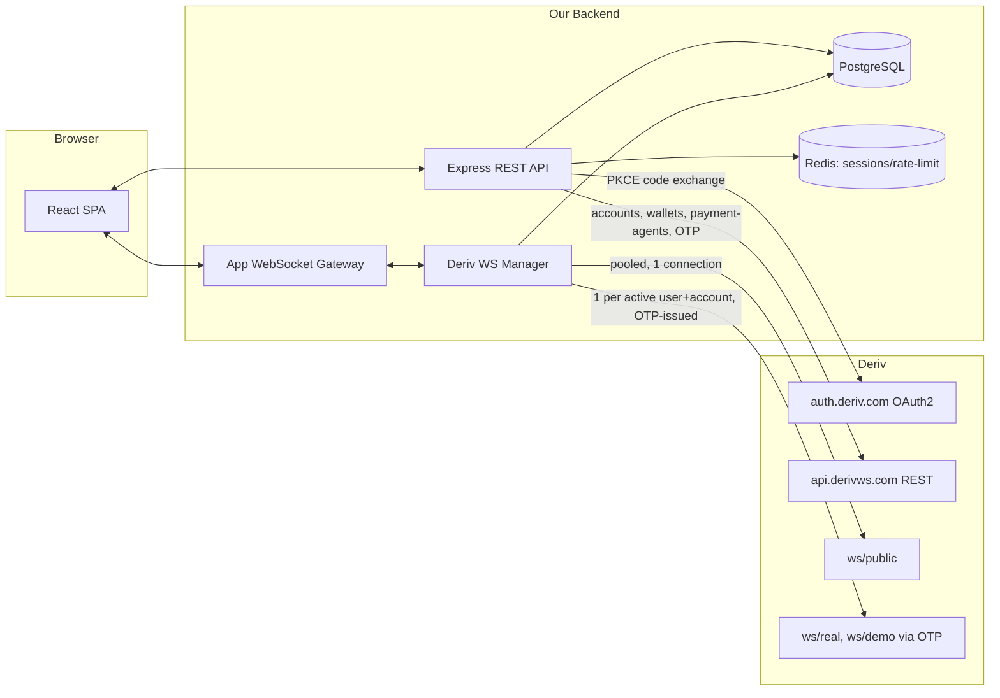

# Phase 1 — Discovery & Architecture
**Working name:** DerivDesk (placeholder — trivial to rename before Phase 2; swap in your real app name and this doc, the package names, and the Deriv app registration all follow it)

> Scope note: your brief left `[APP NAME]` blank and said "also add my admin dashboard." Section 28 of your spec already sketched a light admin area — I've expanded that into a first-class module (own routes, own DB rows, own API namespace) rather than starting a second application. If you actually want a fully separate admin app/deployment, say so and Phase 2 splits it out.

---

## 0. Critical correction before anything else

Your spec (and almost every Deriv tutorial/GitHub sample from the last few years) assumes the **legacy model**: one long-lived authenticated WebSocket, opened by sending an `{"authorize": "<token>"}` message on it.

**That's no longer how the current, documented API works.** I pulled the live docs at developers.deriv.com just now. Current model:

| | Legacy assumption (in most tutorials) | Current documented API |
|---|---|---|
| Auth handshake | Send `authorize` message on an open WS | No auth message on the socket at all |
| Getting a trading socket | Open one socket, authorize it, done | `POST /trading/v1/options/accounts/{accountId}/otp` (REST, Bearer token) → returns a one-time-password **URL** → you connect to *that* URL |
| Switching demo ↔ real | Re-authorize the same socket with a different token | Request a **new OTP** and connect to a **different endpoint** (`/ws/real` vs `/ws/demo`) — they are not the same socket |
| Market data | Same authenticated socket | Separate, unauthenticated public gateway: `wss://api.derivws.com/trading/v1/options/ws/public` |
| Account discovery | `authorize` response returned account list | `GET /trading/v1/options/accounts` (REST) — returns `account_id`, `balance`, `currency`, `account_type: "demo"|"real"`, `status` |

This isn't a nuance — it changes the shape of the WebSocket manager, the demo/real switcher, and the reconnect logic throughout your spec (sections 4–10). Everything below is written against the current model, not the legacy one. Anywhere I couldn't find field-level detail in the concept docs (rather than the raw JSON schemas), I've said so explicitly instead of inventing it — per your own rule in section 35.

Source: https://developers.deriv.com/docs/ (fetched today; concept guides at `developers.deriv.com/llms/*.md`).

---

## 1. Requirements summary (condensed)

Non-negotiable constraints carried through every phase:
- User connects **their own** Deriv account via OAuth 2.0 + PKCE (or PAT for dev/CLI use only). We never see or store a Deriv password.
- We never hold, pool, or represent ourselves as custodian of client funds. Deriv is the source of truth for balance, positions, and transaction status — always.
- Demo and real accounts are visually and structurally distinct at every layer, not just a UI badge.
- No fabricated balances, deposits, withdrawals, or trade outcomes, ever — including in the admin dashboard.
- Deposits/withdrawals implemented only via mechanisms the current API actually exposes (see §2) — no invented endpoints.
- Multi-tenant isolation: a user can never reach another user's data via ID manipulation (IDOR/BOLA).
- **New:** an internal Admin Dashboard for operating the platform — user/connection health, audit trail, support triage — with a hard rule that admins can view metadata but can never see a live Deriv token or place/alter a trade on a client's behalf.

---

## 2. Deriv API capability matrix (verified against current docs)

| Feature | Supported today? | Surface | Auth | Scope | Implementation approach |
|---|---|---|---|---|---|
| Login/authorize | ✅ | REST (OAuth2 Authorization Code + PKCE) | `auth.deriv.com/oauth2/auth` → `/oauth2/token` | n/a | Backend-only PKCE exchange; browser never sees `client_secret` or refresh token |
| Account discovery | ✅ | REST `GET /trading/v1/options/accounts` | Bearer | `trade` | Returns `account_id`, `balance`, `currency`, `account_type` (`demo`/`real`), `status`, `group` — this **is** our demo/real switch data source |
| Account creation | ✅ | REST `POST /trading/v1/options/accounts` | Bearer | `account_manage` | Used only if we ever offer "create a demo account" in-app |
| Reset demo balance | ✅ | REST `POST /trading/v1/options/accounts/{id}/reset-demo-balance` | Bearer | `account_manage` | Powers a "reset demo" button — real accounts obviously excluded |
| Account nickname | ⚠️ Read-only | REST `GET /account/v1/nickname` | Bearer | `account_manage` | No PATCH/rename endpoint is documented — we display it, we don't let users edit it from our UI |
| WS trading session | ✅ | REST `POST /trading/v1/options/accounts/{id}/otp` → WS URL | Bearer (+`Deriv-App-ID` for PAT) | `trade` | One OTP round-trip per (user, account) per connect/reconnect; OTP URLs are short-lived, never cached long-term |
| Market data (ticks, active_symbols, trading_times, time) | ✅ | WS public, `wss://.../ws/public` | none | n/a | One pooled backend connection serves all app users — no per-user auth needed |
| Historical candles | ✅ | WS public `ticks_history` | none | n/a | Same pooled connection |
| Price proposal (quote) | ✅ | WS public `proposal` | none | n/a | Pricing is unauthenticated; only the eventual `buy` call is |
| Buy | ✅ | WS authenticated `buy` | OTP session | `trade` | Confirmed request/response schema (contract params, `price`, returns `contract_id`/`transaction_id`/`buy_price`/`payout`) |
| Sell | ✅ (exists) | WS authenticated `sell` | OTP session | `trade` | Endpoint confirmed in the current index; field-level schema to be pulled from `llms/sell.md` at implementation time rather than assumed here |
| Cancel (deal cancellation) | ✅ (exists) | WS authenticated `cancel` | OTP session | `trade` | Same — confirmed to exist, schema TBD at Phase 5 |
| Update SL/TP on open contract | ✅ (exists) | WS authenticated `contract_update` / `contract_update_history` | OTP session | `trade` | For multiplier/accumulator contracts per your §9 |
| Portfolio (open positions) | ✅ | WS authenticated `portfolio` | OTP session | `trade` | Confirmed schema: returns `contracts[]` |
| Live position updates | ✅ | WS authenticated `proposal_open_contract` (subscribe) | OTP session | `trade` | Drives the real-time P/L ticking in the UI |
| Balance | ✅ | WS authenticated `balance` (subscribe) | OTP session | `trade` | Real-time balance push |
| Transaction/statement/closed-trade history | ✅ | WS authenticated `statement` / `transaction` / `profit_table` | OTP session | `trade` | Backs Transactions + Analytics sections |
| Wallet list | ✅ | REST `GET /wallet/v1/wallets` | Bearer | `payment` | New wallet model, separate from the trading-account balance above |
| Wallet transactions | ✅ | REST `GET /wallet/v1/transactions/{wallet_type}` | Bearer | `payment` | |
| Wallet ↔ wallet transfer | ✅ | REST `POST /wallet/v1/transfers` | Bearer | `payment` | Same-currency, own wallets only, idempotent via `request_id` |
| Wallet ↔ trading-account transfer | ⚠️ Exists, under-documented | REST `POST /wallet/v1/transfers/platforms` | Bearer | `payment` | Endpoint confirmed in the index; concept guide didn't give field-level detail — **verify against the raw JSON schema in Phase 2 before building on it** |
| **Fiat deposit (card/bank/e-wallet)** | ❌ **Not exposed via API** | — | — | — | No deposit endpoint exists anywhere in the current docs. This happens only on Deriv's own cashier web UI. Our app links out to it; we never simulate it |
| Withdrawal via payment agent | ✅ | REST `POST /payment-agents/v1/withdraw` (+ `/verification_code`, + status by `request_id`) | Bearer | `payment` | Requires a 6-digit OTP obtained from a separate verification-code call; status is `requested→pending→complete/rejected/failed` |
| **Direct bank/card withdrawal** | ❌ **Not exposed via API** | — | — | — | Only the payment-agent path above is API-reachable; a user without an eligible payment agent in their region withdraws via Deriv's own cashier, outside our app |
| Payment agent discovery | ✅ | REST `GET /payment-agents/v1/agents`, `/agents/{id}`, `/agent-statistics` | Bearer | `payment` | Powers the "choose an agent" step before withdrawal |
| Bulk purchase (multi-account) | ⚠️ Exists, wrong auth model for us | REST `POST /trading/v1/options/contracts/bulk-purchase/{real,demo}` | `Deriv-App-ID` + **raw per-account PATs in the body** (never Bearer) | `trade` | Conflicts with our least-privilege OAuth design (would require storing raw client PATs) — **excluded from MVP** |
| Automated strategies (`auto_start/stop/pause/resume/list/get`) | ⚠️ Exists, undocumented here | WS | OTP session (assumed) | `trade` (assumed) | Endpoints are listed in the index but weren't detailed in the concept guides I pulled — flag as "verify before use," don't build against it yet |
| System health | ✅ | REST `GET /v1/health` | none | n/a | For our own uptime checks |
| Partner/markup analytics | ✅ but irrelevant | REST | Bearer | `application_read` | For app owners monetizing markup — not needed for a retail client dashboard |

**Correction (made in Phase 4, against `developers.deriv.com/docs/limits/` directly rather than the concept-guide summaries used above):** the rate-limit figures originally written here were wrong — not "5 connections/user, 100 subs/connection, 100 req/s" as first stated, but **shared per-minute/per-hour budgets by call group**, checked directly against the Limits page:

| Calls sharing one budget | Per minute | Per hour |
|---|---|---|
| `proposal`, `proposal_open_contract`, `buy`, `sell` | 360 | 14,400 |
| `balance`, `statement` | 100 | 2,000 |
| `portfolio`, `profit_table` | 30 | 1,500 |
| All other calls (`active_symbols`, `ticks`, `ticks_history`, `time`, `trading_times`, …) | 220 | 14,400 |

`ping` is uncounted (10/sec/connection). REST: 300/min and 1,000/10min per IP, 80/min per logged-in user — the account limit binds first once logged in. There is no stated cap on concurrent connections or subscriptions-per-connection; the actual binding constraint is these shared call-group budgets. This changes the WS manager's design: pooling one public connection across all app users isn't about a connection cap, it's about not letting many users' individual `active_symbols`/`ticks`/`ticks_history` calls collectively blow the *shared* 220/min budget that one Deriv app draws from. Section 8 (WebSocket architecture) and Phase 4's `docs/phase4-market-data.md` build against this corrected table — the architecture decisions below (pooling, single connection) still hold, just for this reason instead of the original one. Source: [Limits](https://developers.deriv.com/docs/limits/), [Best practices](https://developers.deriv.com/docs/best-practices/).

---

## 3. Architecture decisions

1. **The browser never talks to Deriv directly.** All REST and WebSocket traffic to Deriv flows through our backend. This is required anyway (tokens can't reach the browser) and it's what lets us multiplex against the 5-connection cap.
2. **One authenticated OTP session per (user, active account) at a time**, not one per tab. Our own backend-to-frontend WebSocket gateway fans that single upstream session out to as many browser tabs as the user has open, using normalized events.
3. **Switching demo ↔ real is a reconnect, not a re-authorize.** Since it's a different endpoint (`/ws/real` vs `/ws/demo`) behind a fresh OTP, the frontend's "environment switch" triggers: tear down current OTP session → request new OTP for the target account → connect → resubscribe (balance, portfolio, proposal_open_contract). The UI shows a brief "switching accounts" state rather than pretending it's instantaneous.
4. **One pooled, unauthenticated public WS connection** (ticks, active_symbols, proposal pricing) shared across all app users on the backend — this doesn't touch any individual user's 5-connection quota and dramatically cuts total connections.
5. **Deposits/withdrawals are honest about the gap.** Deposits always deep-link to Deriv's cashier. Withdrawals offer the payment-agent flow in-app where available; everything else deep-links out. The UI never implies a card/bank withdrawal happens "in" our app.
6. **Tokens:** OAuth refresh tokens encrypted at rest (AES-256-GCM, key from a KMS/secrets manager, not hardcoded); access tokens live in Redis with a TTL matching Deriv's expiry, never written to disk long-term, never sent to the browser.
7. **Admin Dashboard is a role, not a second app.** `users.role ∈ {client, admin}`. Every admin route sits behind authorization middleware that checks role **and** still enforces the same "never see a raw Deriv token, never place a trade" boundary — admin capability is operational (suspend an app account, inspect connection health, read the audit log), never financial.



---

## 4. Threat model (lightweight STRIDE pass)

| Threat | Vector | Mitigation |
|---|---|---|
| Spoofing | Stolen session cookie | HttpOnly + Secure + SameSite=Strict cookies; short session TTL; IP/device-change flagging |
| Tampering | Client sends a fabricated balance, account ID, or trade result | Backend never trusts client-supplied financial fields — every number is re-derived from Deriv or our reconciled cache, keyed by the authenticated session's user ID |
| Repudiation | User disputes a trade or withdrawal | `audit_logs` row on every financial action, cross-referenced to Deriv's own `contract_id`/`transaction_id`/`request_id` |
| Information disclosure | OAuth token leak (log line, error message, DB dump) | Encryption at rest, redacted logging (never log `Authorization` headers or token values), tokens never leave the backend |
| Denial of service | Runaway WS reconnects, or many users' market-data calls together burning the shared 220/min budget | Single-flight reconnect logic per user, exponential backoff with jitter, a backend-side outbound rate limiter on the pooled public connection (Phase 4), circuit breaker after repeated OTP failures |
| Elevation of privilege | IDOR — user A requests user B's `deriv_account_id` | Every query scoped by `WHERE user_id = :sessionUserId`, tested explicitly for BOLA in Phase 9 |
| Admin-specific | An admin (or a compromised admin account) tries to trade on a client's behalf | No code path in the admin API namespace calls `buy`/`sell`/`payment-agents/withdraw` at all — it's architecturally absent, not just permission-gated |
| Admin-specific | Admin dashboard becomes a bigger attack surface than the client app | Separate `/admin` route tree behind role check + optional step-up auth (re-auth or TOTP) for admin login, its own stricter rate limits and audit logging of every admin read, not just writes |

---

## 5. Database schema (PostgreSQL, via Prisma)

Kept intentionally lean — per your own §19, we're not duplicating Deriv's database, only what we need for reconciliation, auditability, analytics, and UX speed.

```
users
  id, handle (primary Deriv account id, unique), status[active|suspended],
  -- legacy, nullable, unused since the Deriv-only sign-up change: email, password_hash
  created_at, last_login_at

sessions
  id, user_id → users, created_at, expires_at, ip, user_agent

deriv_oauth_tokens
  id, user_id → users, auth_type[oauth|pat], access_token_enc, refresh_token_enc,
  scopes, expires_at, deriv_client_id

deriv_accounts                        -- mirror of GET /accounts, cache only
  id, user_id → users, deriv_account_id, account_type[demo|real], currency,
  group, status, nickname, cached_balance, cached_balance_at

watchlists / watchlist_items
  id, user_id → users, symbol, sort_order

local_trades                          -- read-model, reconciled against Deriv
  id, user_id → users, deriv_account_id → deriv_accounts, contract_id,
  transaction_id, contract_type, underlying_symbol, buy_price, payout,
  purchase_time, status[open|closed|sold|cancelled], last_synced_at

transactions_cache                    -- paginated view over statement/transaction
  id, user_id → users, deriv_account_id → deriv_accounts, deriv_transaction_id,
  type, amount, currency, balance_after, occurred_at, source

payment_agent_withdrawals             -- our record of a withdrawal we initiated
  id, user_id → users, deriv_account_id → deriv_accounts, agent_id, amount,
  currency, request_id, status, created_at, updated_at

analytics_snapshots                   -- derived only from local_trades/transactions_cache
  id, user_id → users, deriv_account_id → deriv_accounts, period,
  win_rate, net_pnl, trades_count, computed_at

notifications
  id, user_id → users, type, payload, read_at, created_at

audit_logs                            -- every financial action + every admin action
  id, actor_user_id → users, actor_role, action, target_type, target_id,
  metadata, ip, created_at

feature_flags
  id, key, enabled, updated_by → users, updated_at
```

Indexes worth calling out now: `local_trades(user_id, status)`, `transactions_cache(user_id, occurred_at desc)`, `audit_logs(actor_user_id, created_at desc)`, `deriv_accounts(user_id, account_type)`. Full migration files land in Phase 2.

---

## 6. Frontend information architecture

**Client app** (role = client) — matches your §15, unchanged:
`/dashboard · /markets · /markets/:symbol · /trade/:symbol · /portfolio · /analysis · /transactions · /payments · /account · /settings`

`/payments` shows: current wallet balances, a "Deposit on Deriv" button that deep-links to Deriv's cashier (never an in-app form), and a withdrawal flow that either walks through the payment-agent path (agent selection → amount → OTP verification → status) or, where no agent applies, explains that withdrawal happens on Deriv's own cashier.

**Admin dashboard** (role = admin, separate layout, `/admin/*`, gated):

| Route | Purpose |
|---|---|
| `/admin/overview` | Platform health at a glance: connected-account count, active WS sessions, error rate, API latency |
| `/admin/users` | Search/list app users; view connection status; suspend/reactivate an *app* account (never a Deriv account) |
| `/admin/connections` | Per-user Deriv connection health — last sync time, token expiry countdown, reconnect state. Token values are never rendered, not even masked |
| `/admin/withdrawals` | Read-only view of `payment_agent_withdrawals` + live status, for support triage — annotate, don't initiate |
| `/admin/audit-log` | Searchable, filterable `audit_logs` |
| `/admin/feature-flags` | Toggle `feature_flags` |
| `/admin/system` | Rate-limit headroom against Deriv's caps, WS pool stats, error monitoring feed |

Hard rule surfaced in the UI itself, not just the backend: nowhere in `/admin/*` is there a button that can place, close, or modify a trade, or move money.

---

## 7. API architecture (our backend, not Deriv's)

```
Auth
  POST   /api/auth/logout            -- (no register/login: users sign in with Deriv, below)
  GET    /api/auth/me

Deriv connection
  GET    /api/deriv/login                -- SIGN IN / SIGN UP: PKCE authorization URL (unauthenticated)
  GET    /api/deriv/connect              -- reconnect Deriv for the signed-in user
  GET    /api/deriv/callback             -- validates state, exchanges code
  GET    /api/deriv/accounts             -- our cached mirror of GET /trading/v1/options/accounts
  POST   /api/deriv/accounts/:id/activate -- switch active account (triggers OTP reconnect)
  DELETE /api/deriv/accounts/:id         -- revoke/disconnect

Markets
  GET    /api/markets
  GET    /api/markets/:symbol
  GET    /api/markets/:symbol/candles

Trading
  POST   /api/trading/proposal
  POST   /api/trading/buy
  POST   /api/trading/sell
  GET    /api/trading/portfolio
  GET    /api/trading/history

Transactions
  GET    /api/transactions

Payments
  GET    /api/payments/wallets
  GET    /api/payments/agents
  POST   /api/payments/withdraw            -- payment-agent path only
  GET    /api/payments/withdraw/:requestId
  GET    /api/payments/deposit-link        -- returns the Deriv cashier deep link, nothing else

Analytics
  GET    /api/analytics/summary
  GET    /api/analytics/performance

Admin (role=admin only; every call also writes an audit_logs row)
  GET    /api/admin/overview
  GET    /api/admin/users
  PATCH  /api/admin/users/:id/status       -- suspend/reactivate the app account only
  GET    /api/admin/connections
  GET    /api/admin/withdrawals
  GET    /api/admin/audit-log
  GET    /api/admin/feature-flags
  PATCH  /api/admin/feature-flags/:key
  GET    /api/admin/system
```

---

## 8. WebSocket architecture

Two distinct hops — don't conflate them:

**Hop 1 — Frontend ↔ our WS gateway.** Normalized, transport-agnostic events so React components never touch a raw Deriv message shape:
`MARKET_TICK · BALANCE_UPDATED · POSITION_UPDATED · CONTRACT_UPDATED · TRANSACTION_UPDATED · CONNECTION_CHANGED · TRADE_ERROR`

**Hop 2 — Our backend ↔ Deriv.**
- One pooled public connection (no auth) for ticks/active_symbols/proposal pricing, shared across all users.
- One OTP-issued private connection per (user, currently-active account). On account switch or token refresh, the manager tears down the old socket, requests a fresh OTP, connects to the correct `/ws/real` or `/ws/demo` endpoint, and resubscribes (`balance`, `portfolio`, `proposal_open_contract`).
- Reconnect logic: exponential backoff with jitter, capped attempts before surfacing `CONNECTION_CHANGED: degraded` to the frontend rather than looping silently.
- The manager enforces the *actual* constraint from §2's corrected table: a shared outbound-request rate limiter for the "all other calls" budget (220/min) on the pooled public connection, so many users' `active_symbols`/`ticks`/`ticks_history` calls collectively can't exceed what Deriv allows for this app. There is no connection-count cap to track.

---

## 9. Project structure

```
derivdesk/
├── apps/
│   ├── web/                 # React + TS + Vite (client + /admin routes)
│   └── api/                 # Express + TS
│       ├── src/
│       │   ├── modules/
│       │   │   ├── auth/
│       │   │   ├── deriv/           # OAuth, OTP, WS manager, REST adapter
│       │   │   ├── trading/
│       │   │   ├── payments/
│       │   │   ├── analytics/
│       │   │   └── admin/
│       │   ├── ws-gateway/
│       │   ├── middleware/          # auth, role-check, rate-limit, audit
│       │   └── lib/
│       └── prisma/
│           ├── schema.prisma
│           └── migrations/
├── packages/
│   └── shared-types/         # DTOs shared between web and api
├── docker-compose.yml
├── .env.example
└── README.md
```

---

## 10. Known limitations & open items (carried forward, not hidden)

- **No fiat deposit API** — every deposit happens on Deriv's own cashier; we link out.
- **No direct bank/card withdrawal API** — only the payment-agent path is reachable from our app; everything else is a cashier deep link.
- `wallet/v1/transfers/platforms` needs a live sandbox call in Phase 2/3 before we build UI on it — the concept guide names it but doesn't give field-level detail.
- `sell`, `cancel`, `contract_update` — confirmed to exist, but I'm not going to invent their exact request schemas here; Phase 5 pulls the live schema files before wiring the buttons.
- Automated-strategy endpoints (`auto_*`) exist in the docs index but are undocumented in the concept guides — out of scope until independently verified.
- Bulk-purchase requires raw per-account PATs in the request body, which breaks our least-privilege OAuth model — excluded from MVP by design, not oversight.
- Account nickname editing isn't possible — the current API only exposes a `GET`.

---

## 11. Next step

Phase 2 (project foundation: monorepo, Prisma migrations for the schema above, Docker Compose, auth scaffolding, CI) is ready to start as soon as you confirm:
1. the real app name (or keep "DerivDesk"), and
2. whether the admin dashboard should ship inside this app (as designed above) or as a fully separate deployment.
